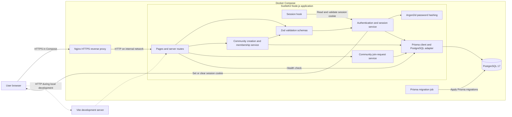

_This project has been created as part of the 42 curriculum by ailbezer, jhualves, ratanaka and yvieira-_

# Transcendence

## Description

This project is a SvelteKit application with PostgreSQL persistence, user registration and login, server-side sessions, and authenticated community creation. The broader product scope and future features are still to be defined by the team.

**Implemented features:** Account registration, login and logout; protected dashboard; persistent sessions; database health endpoint; community creation with visibility and membership policies; and join requests for approval-based communities.

## Subject Requirements Checklist

Status reflects the current repository and documentation. “Not verified” means the requirement needs runtime or evaluator confirmation; it is not being claimed as complete based on configuration alone.

### Mandatory application requirements

| Requirement                                                                                              | Status                | Assessment                                                                                                                                                                                            |
| -------------------------------------------------------------------------------------------------------- | --------------------- | ----------------------------------------------------------------------------------------------------------------------------------------------------------------------------------------------------- |
| Web application with a frontend, backend, and database                                                   | Implemented           | SvelteKit provides the UI and server routes, with PostgreSQL persistence through Prisma.                                                                                                              |
| Git usage, clear commits, contributions from all team members, and appropriate work distribution         | Partially implemented | The history contains meaningful feature commits and multiple author identities, but the identities do not clearly map to all four README logins; confirm each member’s contributions and attribution. |
| Containerized deployment that runs with one command                                                      | Partially implemented | Docker Compose starts the app, Nginx, and PostgreSQL with `make compose-up`; database migrations must currently be applied separately before first use.                                               |
| Compatibility with the latest stable Google Chrome                                                       | Not verified          | Playwright/Chromium tests exist, but compatibility with the latest stable Chrome has not been confirmed.                                                                                              |
| No JavaScript warnings or errors in the browser console                                                  | Not verified          | No documented browser-console verification is available.                                                                                                                                              |
| Accessible Privacy Policy and Terms of Service pages with relevant, non-placeholder content              | Not implemented       | Neither page is present in the application.                                                                                                                                                           |
| Multiple users can use the application simultaneously without conflicts                                  | Partially implemented | User data and sessions are persisted independently, but concurrent multi-user behavior has not been demonstrated beyond authentication.                                                               |
| Appropriate concurrent behavior, applicable real-time updates, and no data corruption or race conditions | Not implemented       | There are no multi-user interaction or real-time features, and concurrent-use behavior has not been validated.                                                                                        |
| Assign the required team roles and have all members contribute to the mandatory part and modules         | Not implemented       | Team roles are not assigned in the README, and current feature/module attribution lists ailbezer; document and verify each member’s contribution.                                                     |
| Ensure every team member can explain the project and their work                                          | Not verified          | The README does not record whether this has been confirmed with the team.                                                                                                                             |

### Mandatory technical requirements

| Requirement                                                         | Status                | Assessment                                                                                                                                                   |
| ------------------------------------------------------------------- | --------------------- | ------------------------------------------------------------------------------------------------------------------------------------------------------------ |
| Clear, responsive, accessible frontend across devices               | Partially implemented | Tailwind styling and labeled forms are present; full-device responsiveness and accessibility have not been verified.                                         |
| Use a CSS framework or styling solution                             | Implemented           | The application uses Tailwind CSS.                                                                                                                           |
| Keep credentials in a Git-ignored `.env` and provide `.env.example` | Implemented           | `.env` is ignored, `.env.example` is tracked, and Compose reads credentials from environment variables.                                                      |
| Clear database schema with well-defined relations                   | Implemented           | The Prisma schema defines users, sessions, OAuth accounts, communities, and memberships with relations and constraints.                                      |
| Secure basic sign-up and login with salted, hashed passwords        | Implemented           | Email/password authentication uses Argon2id password hashes and server-side sessions.                                                                        |
| Validate all forms and user input in both frontend and backend      | Partially implemented | Forms use native HTML constraints and server actions validate with Zod; complete coverage and matching client/server validation have not been verified.      |
| Use HTTPS for connections to the backend                            | Partially implemented | The Compose deployment routes browser traffic through HTTPS in Nginx; local development uses HTTP, so HTTPS is not enforced in every documented environment. |

### Minimum module points

| Requirement                               | Status          | Assessment                                                                                                                                      |
| ----------------------------------------- | --------------- | ----------------------------------------------------------------------------------------------------------------------------------------------- |
| Complete modules worth at least 14 points | Not implemented | The README currently documents SvelteKit (2 points) and Prisma (1 point), for 3 points total; 11 more points are needed, subject to evaluation. |

### README requirements

| Requirement                                                                 | Status                | Assessment                                                                                                                                                |
| --------------------------------------------------------------------------- | --------------------- | --------------------------------------------------------------------------------------------------------------------------------------------------------- |
| README at repository root with the required italicized first line           | Implemented           | This README is at the repository root and begins with the requested 42 curriculum line.                                                                   |
| Description with project name, goal, and key features                       | Partially implemented | The name and current features are listed, but the project goal and final product scope remain open.                                                       |
| Instructions with prerequisites and step-by-step installation and execution | Implemented           | Setup, development, Compose, migrations, and useful commands are documented.                                                                              |
| Resources section with references and an explanation of AI usage            | Implemented           | Documentation links and the current AI usage statement are included.                                                                                      |
| Team roles and responsibilities for every listed member                     | Not implemented       | The team table still has “To be defined” for roles and responsibilities.                                                                                  |
| Project organization, management tools, and communication channels          | Not implemented       | These details are still “To be defined.”                                                                                                                  |
| Technical stack and rationale for major choices                             | Partially implemented | The technologies and uses are listed, but some choice justifications (including why PostgreSQL was selected) are not documented.                          |
| Database structure, relationships, and key fields/types                     | Partially implemented | Models and relationships are described; field types or a visual schema are not fully documented in the README.                                            |
| Complete implemented-features list, descriptions, and contributors          | Partially implemented | Community creation is documented and attributed to ailbezer; OAuth is not implemented.                                                                    |
| Selected modules, points, implementation, justification, and contributors   | Implemented           | The two selected modules, their rationale, point values, implementation, and contributor are listed; this does not meet the separate 14-point minimum.    |
| Detailed individual contributions and challenges for every member           | Partially implemented | Feature and module tables attribute implemented work to ailbezer, but the individual-contributions table and challenge descriptions are still incomplete. |

## Instructions

### Prerequisites

- Node.js v24.21.0 (LTS) and npm v11.19.0.
- Docker Engine and Docker Compose v2 to run the containerized services.
- Git to clone the repository.

### Run in development

1. Clone the repository and open its directory.
2. Install the dependencies:

   ```sh
   make install
   ```

3. Start the development database, apply migrations, and start the development server:

   ```sh
   make dev
   ```

4. Open the URL printed by Vite in the terminal (usually `http://localhost:5173`).

`make dev` requires Docker and uses the PostgreSQL test database on `localhost:5434`. The database remains running after stopping the development server. The app reads and writes user and session data in this database.

Available pages are `/cadastro` (registration), `/login`, `/dashboard`, `/perfil`, and `/communities/new` (authenticated community creation). The dashboard, profile, and community creation pages redirect unauthenticated visitors to the login page. `POST /logout` revokes the current session, and `/health` checks the database connection.

### Run with Docker Compose

Compose starts the application, Nginx, and PostgreSQL. Create a local `.env` file from the provided template:

```sh
cp .env.example .env
```

```sh
make compose-up
```

The application will be available at `https://localhost`. Nginx generates a self-signed certificate for development, so the browser may show a security warning. Stop the services without removing database data with:

```sh
make compose-down
```

Apply the Prisma migrations to the Compose database before using the application:

```sh
docker compose --profile tools run --rm db-tools
```

### Useful commands

| Command                       | Description                                                                                          |
| ----------------------------- | ---------------------------------------------------------------------------------------------------- |
| `make lint`                   | Run ESLint.                                                                                          |
| `make check`                  | Run Svelte and TypeScript checks.                                                                    |
| `make format-check`           | Check formatting with Prettier.                                                                      |
| `make test`                   | Run unit and component tests with `vitest.unit.config.ts`.                                           |
| `make test-watch`             | Run unit and component tests in Vitest watch mode.                                                   |
| `make test-integration`       | Run integration tests with `vitest.integration.config.ts` against a temporary PostgreSQL database.   |
| `make test-e2e`               | Run browser end-to-end tests against a temporary PostgreSQL database (requires Docker and Chromium). |
| `make test-all`               | Run unit, integration, and end-to-end tests.                                                         |
| `make build`                  | Create the production build.                                                                         |
| `make verify`                 | Run formatting, lint, checks, all tests, and the production build.                                   |
| `make db-migrate name=<name>` | Create and apply a development Prisma migration with the given name.                                 |

Install the Playwright browser once before running end-to-end tests:

```sh
npx playwright install chromium
```

## Team Information

| Member (login) | Role(s)       | Responsibilities |
| -------------- | ------------- | ---------------- |
| _ailbezer_     | To be defined | To be defined.   |
| _jhualves_     | To be defined | To be defined.   |
| _ratanaka_     | To be defined | To be defined.   |
| _yvieira-_     | To be defined | To be defined.   |

## Project Management

- **Work organization:** To be defined (task distribution, meeting schedule, and tracking process).
- **Project management tools:** To be defined (for example, GitHub Issues or Trello).
- **Communication channels:** To be defined (for example, Discord or Slack).

## Technical Stack

| Area                | Technology                                                    | Usage and rationale                                                                                        |
| ------------------- | ------------------------------------------------------------- | ---------------------------------------------------------------------------------------------------------- |
| Frontend            | Svelte 5, SvelteKit 3, TypeScript 6, and Vite 8               | Web application and user interface.                                                                        |
| Backend             | SvelteKit with Node.js 24 LTS (`node:24-alpine` in Docker)    | Server-side routes and authentication services, with the SvelteKit Node adapter.                           |
| Authentication      | Zod and Argon2                                                | Validate registration and login input; store passwords as Argon2id hashes and manage server-side sessions. |
| Database            | PostgreSQL 17 (`postgres:17-alpine` image) and Prisma 7       | Prisma schema, migrations, and a PostgreSQL adapter persist user and session data.                         |
| Infrastructure      | Docker Compose and Nginx                                      | Local service orchestration and HTTPS reverse proxy for the application.                                   |
| Testing and quality | Vitest, Testing Library, Playwright, ESLint, and svelte-check | Unit, integration, and browser end-to-end tests, linting, and static and type checks.                      |

## Application Architecture



## Repository Structure

```text
.
├── .dockerignore                            # Files excluded from Docker build contexts.
├── .env.example                             # Environment variable template for local Compose use.
├── .gitignore                               # Git-ignored files and generated output.
├── .husky/
│   ├── commit-msg                           # Runs commit message validation.
│   ├── pre-commit                           # Runs checks on staged files.
│   └── pre-push                             # Runs checks before pushing.
├── .npmrc                                   # npm configuration.
├── .prettierignore                          # Files excluded from Prettier.
├── .prettierrc                              # Prettier formatting configuration.
├── README.md                                # Project overview, instructions, requirements, and documentation.
├── Dockerfile                               # Multi-stage Docker build for the SvelteKit application.
├── Makefile                                 # Development, Compose, database, and verification commands.
├── commitlint.config.js                     # Conventional commit message rules.
├── compose.yml                              # Production-like app, Nginx, PostgreSQL, and migration services.
├── compose.test.yml                         # PostgreSQL service configuration for tests.
├── eslint.config.js                         # ESLint configuration.
├── nginx/
│   ├── Dockerfile                           # Nginx image and local self-signed TLS certificate setup.
│   └── nginx.conf                           # HTTPS reverse proxy configuration.
├── package.json                             # Dependencies and npm scripts.
├── package-lock.json                        # Locked npm dependency versions.
├── playwright.config.ts                     # Browser end-to-end test configuration.
├── vitest.unit.config.ts                    # Unit and component test configuration.
├── vitest.integration.config.ts             # PostgreSQL integration test configuration.
├── prisma/
│   ├── migrations/
│   │   ├── 20261012132057_init/
│   │   │   └── migration.sql                # Initial user, session, and OAuth schema migration.
│   │   ├── 20261107194703_community_data_model/
│   │   │   └── migration.sql                # Community and membership schema migration.
│   │   └── migration_lock.toml              # Prisma migration provider metadata.
│   ├── schema.prisma                        # Database models, enums, relations, and constraints.
│   └── seed.ts                              # Database seed entry point.
├── prisma.config.ts                         # Prisma CLI configuration.
├── scripts/
│   ├── test-e2e.sh                          # Starts and cleans up the end-to-end test environment.
│   └── test-integration.sh                  # Starts and cleans up the integration test database.
├── src/
│   ├── app.css                              # Global Tailwind CSS entry point.
│   ├── app.d.ts                             # SvelteKit application type declarations.
│   ├── app.html                             # HTML document template.
│   ├── hooks.server.ts                      # Validates session cookies for incoming requests.
│   ├── hooks.server.test.ts                 # Tests for the server hook.
│   ├── lib/
│   │   ├── assets/
│   │   │   └── favicon.svg                  # Application favicon.
│   │   ├── components/
│   │   │   └── .gitkeep                     # Keeps the reserved components directory in Git.
│   │   ├── index.ts                         # Shared library entry point.
│   │   ├── schemas/
│   │   │   ├── auth.ts                      # Zod schemas for registration and login.
│   │   │   ├── auth.test.ts                 # Authentication schema tests.
│   │   │   ├── community.ts                 # Zod schema for community creation.
│   │   │   └── community.test.ts            # Community creation schema tests.
│   │   └── server/
│   │       ├── auth/
│   │       │   └── .gitkeep                 # Keeps the reserved server auth directory in Git.
│   │       ├── db/
│   │       │   └── .gitkeep                 # Keeps the reserved server database directory in Git.
│   │       ├── db.ts                        # Lazy Prisma client and PostgreSQL adapter setup.
│   │       └── services/
│   │           ├── auth.ts                  # Registration, authentication, and session operations.
│   │           ├── auth.test.ts             # Authentication and session service tests.
│   │           ├── community.ts             # Community creation and creator membership.
│   │           ├── community.test.ts        # Community creation service tests.
│   │           ├── community-join-request.ts   # Create, inspect, and cancel community join requests.
│   │           └── community-join-request.test.ts # Join-request service tests.
│   └── routes/
│       ├── +layout.server.ts                # Provides the current user to the shared layout.
│       ├── +layout.svelte                   # Shared navigation and page layout.
│       ├── +page.svelte                     # Public landing page.
│       ├── page.test.ts                     # Landing page tests.
│       ├── cadastro/
│       │   ├── +page.server.ts              # Registration form action and server validation.
│       │   ├── +page.svelte                 # Registration page.
│       │   └── page.server.test.ts          # Registration action tests.
│       ├── dashboard/
│       │   ├── +page.server.ts              # Protects the dashboard route.
│       │   ├── +page.svelte                 # Authenticated dashboard page.
│       │   └── page.server.test.ts          # Dashboard access tests.
│       ├── communities/
│       │   ├── [id]/
│       │   │   └── join-request/
│       │   │       └── +server.ts          # Join-request API: POST, GET, and DELETE.
│       │   └── new/
│       │       ├── +page.server.ts          # Authenticated community creation action.
│       │       ├── +page.svelte             # Community creation form.
│       │       └── page.server.test.ts      # Community creation action tests.
│       ├── health/
│       │   └── +server.ts                   # Database health-check endpoint.
│       ├── login/
│       │   ├── +page.server.ts              # Login action and session-cookie creation.
│       │   ├── +page.svelte                 # Login page.
│       │   └── page.server.test.ts          # Login action tests.
│       └── logout/
│           ├── +server.ts                   # Revokes the session and clears its cookie.
│           └── server.test.ts               # Logout endpoint tests.
├── static/
│   └── robots.txt                           # Search engine crawler instructions.
├── tests/
│   ├── e2e/
│   │   ├── auth.spec.ts                     # Browser end-to-end authentication tests.
│   │   ├── community-join-request.spec.ts   # Browser end-to-end join-request tests.
│   │   └── helpers/                         # Shared Playwright test helpers.
│   └── integration/
│       ├── auth.test.ts                     # Registration and login integration tests.
│       ├── community.test.ts                # Community model and creation integration tests.
│       ├── community-join-request.test.ts   # Join-request database integration tests.
│       ├── health.test.ts                   # Health endpoint integration tests.
│       ├── session.test.ts                  # Persistent session integration tests.
│       └── user.test.ts                     # User data integration tests.
├── tsconfig.json                            # TypeScript configuration.
└── vite.config.ts                           # Vite, SvelteKit, and test configuration.
```

## Database Schema

The Prisma schema defines the models used by authentication and the community data model.

- **User:** `id`, unique normalized `email`, Argon2id `passwordHash`, optional `name` and `avatarUrl`, and `createdAt`.
- **Session:** hashed token `id`, `userId`, and `expiresAt`; sessions last seven days and are deleted when their user is deleted.
- **OAuthAccount:** `id`, `provider`, `providerUserId`, and `userId`; provider identity pairs are unique, and accounts belong to a user. OAuth sign-in is not implemented.
- **Community:** `id`, `name`, optional `description`, `visibility` (`PUBLIC` or `PRIVATE`), and `joinPolicy` (`OPEN` or `APPROVAL`), with creation and update timestamps.
- **CommunityMembership:** links a user to a community with a `role` (`OWNER`, `ADMIN`, or `MEMBER`) and a `status` (`PENDING`, `ACTIVE`, `REJECTED`, or `REMOVED`). A user can have only one membership record per community. Deleting a community deletes its memberships; a user with memberships cannot be deleted.
- **Community creation:** Authenticated users can create a community with a name (up to 100 characters), optional description (up to 2000 characters), visibility (`PUBLIC` or `PRIVATE`), and join policy (`OPEN` or `APPROVAL`). The creator is added as an `OWNER` with `ACTIVE` status as part of the same database operation. The form is available at `/communities/new`.
- **Community join requests:** Authenticated users can request membership in an `APPROVAL` community through `POST /communities/<id>/join-request`. `GET` returns the user's own membership status, and `DELETE` cancels a pending request. Open communities, active members, pending requests, and rejected or removed memberships are handled according to the service rules. Community discovery, detail pages, approvals, and broader member management are not implemented yet.
- **Other community flows:** Community discovery, detail pages, request approval/rejection, and member management are not implemented yet. After creation, the server redirects to `/communities/<id>`; a detail page for that route is still future work.
- **Migrations:** Stored in `prisma/migrations` and applied with `npm run db:deploy`.
- **Development migrations:** Use `make db-migrate name=migration_name` to create and apply a migration against the development database.
- **Health check:** `GET /health` returns HTTP 200 when PostgreSQL is reachable and HTTP 503 otherwise.

## Features List

| Feature                     | Description                                                                      | Team member(s) | Status      |
| --------------------------- | -------------------------------------------------------------------------------- | -------------- | ----------- |
| User registration           | Validates input and stores unique accounts with Argon2id password hashes.        | ailbezer       | Implemented |
| Login, sessions, and logout | Authenticates users, persists seven-day sessions, and supports logout.           | ailbezer       | Implemented |
| Protected dashboard         | Requires an authenticated session to access the dashboard.                       | ailbezer       | Implemented |
| Community creation          | Authenticated users create communities; the creator becomes an active owner.     | ailbezer       | Implemented |
| Community join requests     | Users can create, inspect, and cancel pending requests for approval communities. | ailbezer       | Implemented |
| Database health check       | Reports whether the application can reach PostgreSQL.                            | ailbezer       | Implemented |

## Modules

| Module                            | Category | Points    | Rationale and implementation                                                                                    | Team member(s) |
| --------------------------------- | -------- | --------- | --------------------------------------------------------------------------------------------------------------- | -------------- |
| Full-stack framework (SvelteKit)  | Web      | 2 (Major) | SvelteKit powers the frontend and backend, including Svelte pages, server-side routes, and the Node.js adapter. | ailbezer       |
| Object-relational mapper (Prisma) | Web      | 1 (Minor) | Prisma defines the PostgreSQL data model and provides database access and migrations for users and sessions.    | ailbezer       |

**Implemented module points:** 3 (subject to project evaluation). These modules are documented as implemented features, not as bonus points; the subject considers bonus modules only after the required 14 points have been completed.

## Individual Contributions

Describe each person's work, linking contributions to features, modules, or components and noting challenges and solutions.

| Member (login) | Specific contributions | Challenges and solutions |
| -------------- | ---------------------- | ------------------------ |
| _ailbezer_     | To be defined.         | To be defined.           |
| _jhualves_     | To be defined.         | To be defined.           |
| _ratanaka_     | To be defined.         | To be defined.           |
| _yvieira-_     | To be defined.         | To be defined.           |

## Resources

- [Svelte documentation](https://svelte.dev/docs)
- [SvelteKit documentation](https://svelte.dev/docs/kit)
- [SvelteKit Node adapter](https://svelte.dev/docs/kit/adapter-node)
- [TypeScript documentation](https://www.typescriptlang.org/docs/)
- [Node.js v24 documentation](https://nodejs.org/docs/latest-v24.x/api/)
- [PostgreSQL 17 documentation](https://www.postgresql.org/docs/17/)
- [node-postgres documentation](https://node-postgres.com/)
- [Prisma documentation](https://www.prisma.io/docs)
- [Prisma PostgreSQL driver adapter](https://www.prisma.io/docs/orm/overview/databases/postgresql#using-the-node-postgres-driver)
- [Zod documentation](https://zod.dev/)
- [node-argon2 documentation](https://github.com/ranisalt/node-argon2)
- [RFC 9106: Argon2 Memory-Hard Function for Password Hashing and Proof-of-Work Applications](https://www.rfc-editor.org/rfc/rfc9106)
- [Docker Compose documentation](https://docs.docker.com/compose/)
- [Nginx documentation](https://nginx.org/en/docs/)
- [Vite documentation](https://vite.dev/guide/)
- [Tailwind CSS documentation](https://tailwindcss.com/docs)
- [Vitest documentation](https://vitest.dev/)
- [Testing Library documentation](https://testing-library.com/docs/)
- [Playwright documentation](https://playwright.dev/docs/intro)
- [ESLint documentation](https://eslint.org/docs/latest/)
- [Prettier documentation](https://prettier.io/docs/)

### AI Usage

For this version, AI was used to reorganize and write this README according to the activity requirements, based on the repository's existing configuration files. No application features were implemented with AI in this change. Document any future AI assistance here, including the tasks and project parts involved.

## License

To be defined.
